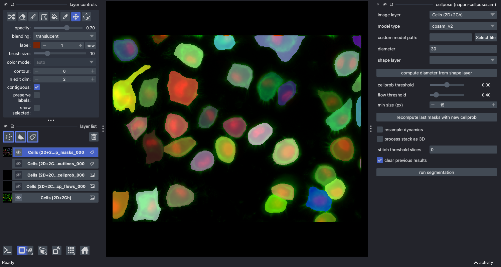

Running plugin
-------------------------------

You can drag and drop a variety of images into napari. See the napari
`image`_ documentation for more advanced image loading.

2D images
~~~~~~~~~~~~~~~~~~~~~~~~~~

Select an image layer, pick a model and click ``run segmentation``. The
plugin adds masks, outlines, cell probability and flow layers. To try it out,
open a sample image from File > Open Sample > napari-cellposesam.

Batch processing in 2D
~~~~~~~~~~~~~~~~~~~~~~~~~~

To process several same-sized 2D images together, open them with
File > Open Files as Stack, which loads them into one layer. Uncheck ``process stack as 3D`` and cellpose segments each image in 2D with
the same settings, adding a separate set of result layers per image. You can
export the results from the napari File menu.

3D segmentation
~~~~~~~~~~~~~~~~~~~~~~~~~~

Cellpose can segment 3D and 4D stacks. ``process stack as 3D`` is checked
automatically when you select a 3D or 4D image; uncheck it to segment each
slice in 2D instead.

With cellpose v4, the widget shows ``z axis`` and ``channel axis`` selectors
for 3D and 4D images. If the napari layer has axis labels ``z`` and ``c``,
they are used as defaults. For a 3D image, set ``channel axis`` to
``none (ZYX)`` if all three axes are spatial. With cellpose v3, label the
channel axis of a 4D image with ``c`` instead.

If the 3D segmentation is not working well and there is inhomogeneity in Z, try stitching 
masks using the ``stitch threshold slices`` option
instead of checking ``process stack as 3D``. In this setting, 
cellpose will create masks in 2D on each XY slice and then stitch them across 
slices if the IoU between the mask on the current slice and the next slice is 
greater than or equal to the ``stitch threshold slices``. 

A 3D sample is available under File > Open Sample > napari-cellposesam.

Time segmentation
~~~~~~~~~~~~~~~~~~~~~~~~~~~

Stitching can also be applied in time by setting ``stitch threshold slices``>0.

.. _image: https://napari.org/stable/howtos/layers/image.html
